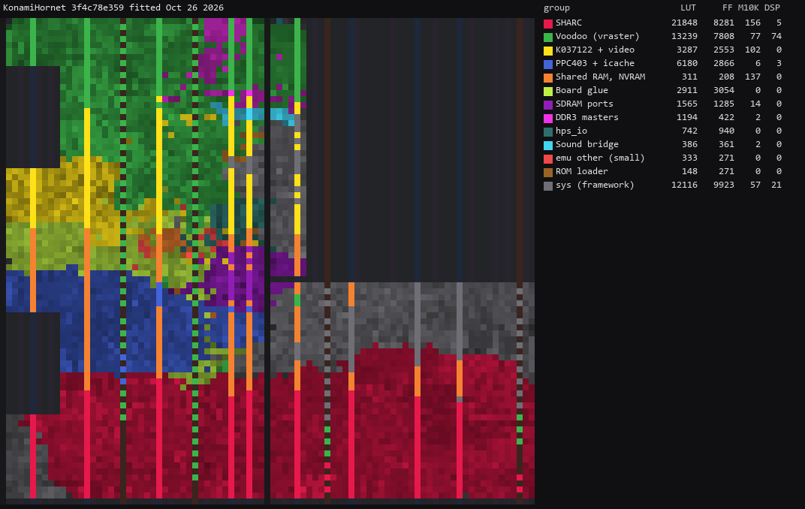
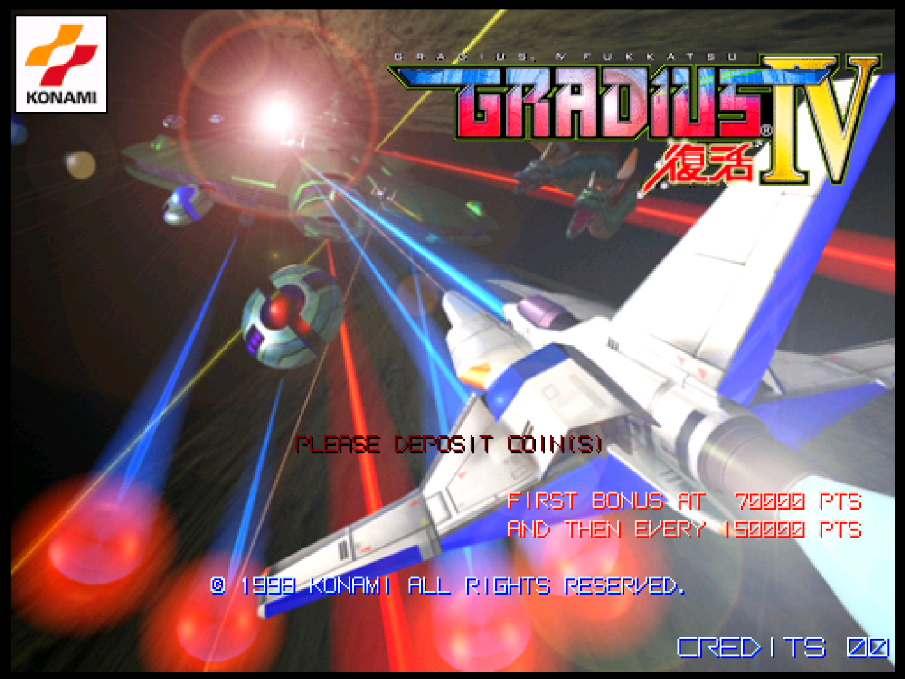
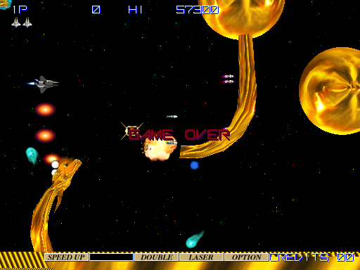
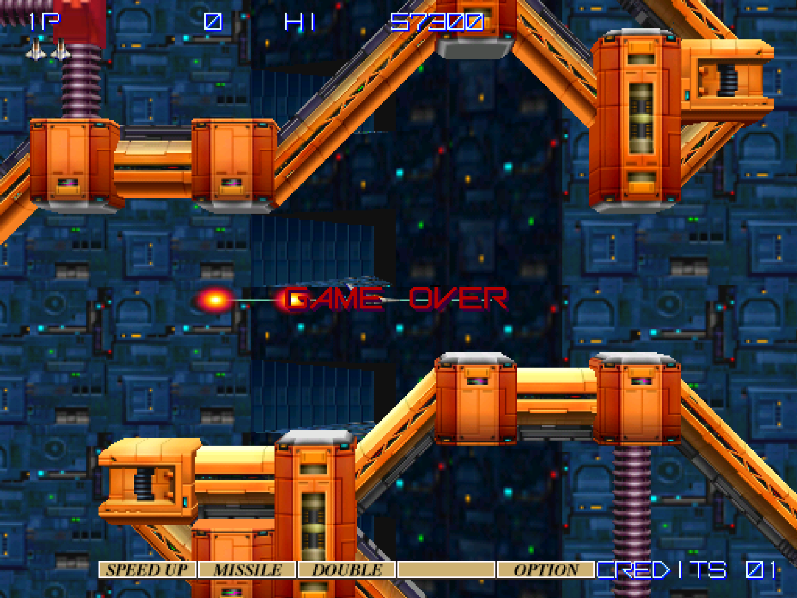
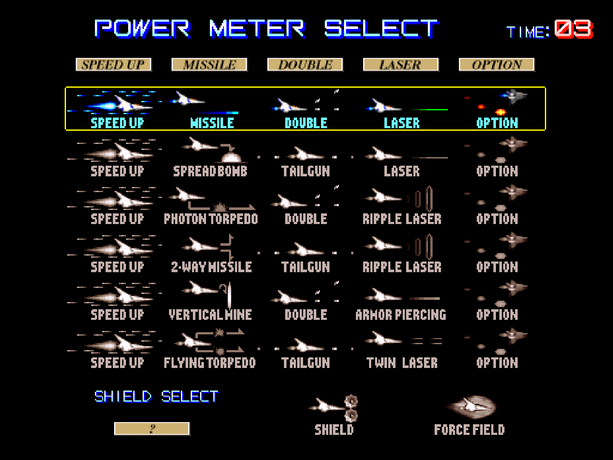
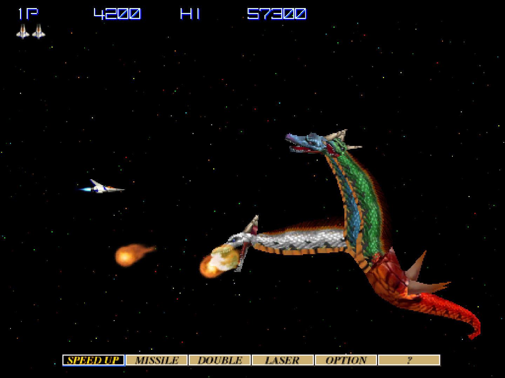
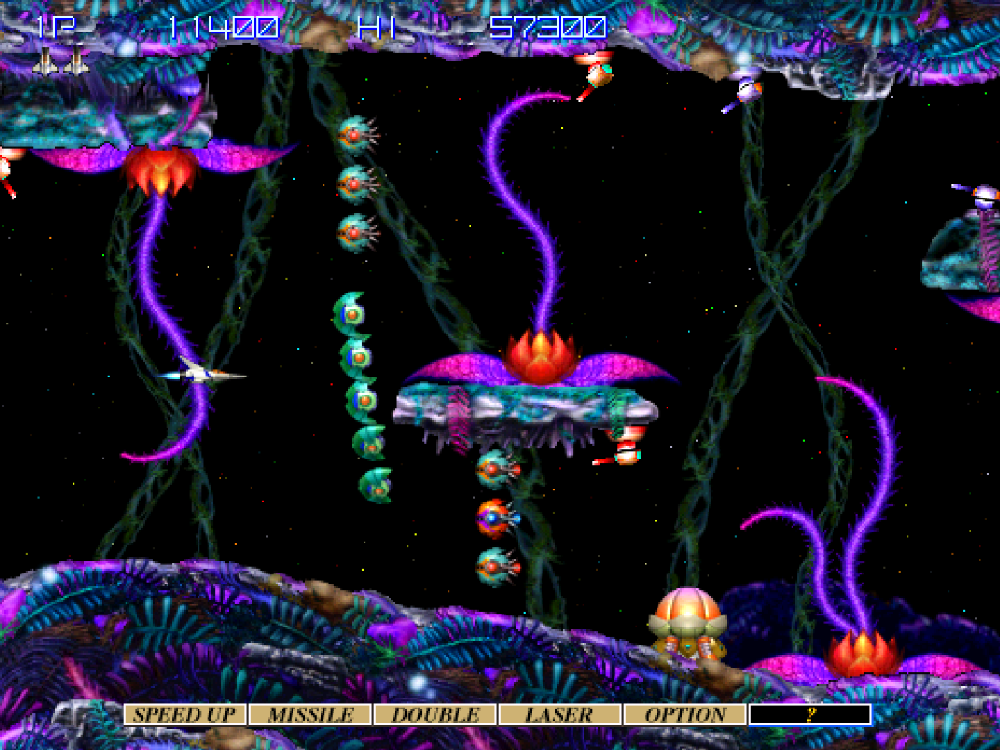
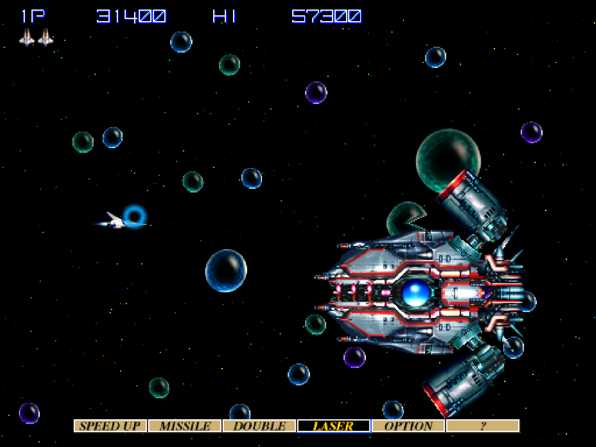
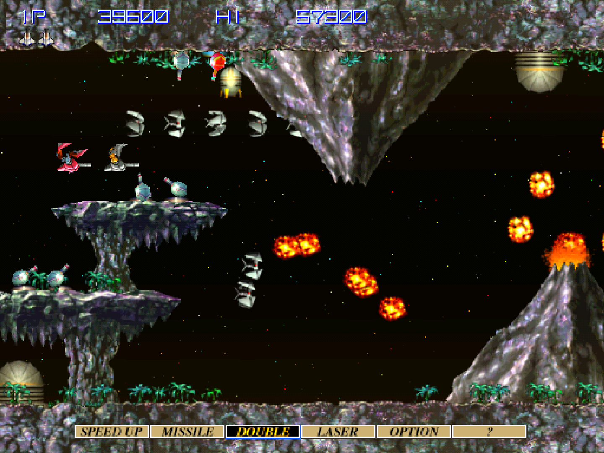
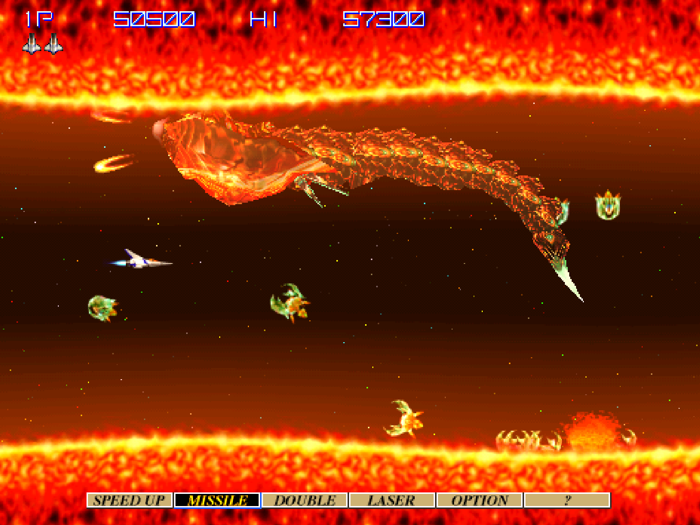

# Konami Hornet core for MiSTer

A MiSTer FPGA core for Konami's Hornet arcade hardware (MAME's `konami/hornet.cpp`), built with
Quartus Prime 17.0.2 Lite for the DE10-nano.

**Status: in development**. Gradius IV boots and plays on a DE10-nano, 2D and 3D
drawn, with sound from the MiSTer's ARM. Doesn't run full-speed on many levels

## Contents

- [History](#history)
- [Games](#games)
  - [Supported](#supported)
  - [Not yet](#not-yet)
  - [Out of scope for now](#out-of-scope-for-now)
- [Hardware](#hardware)
  - [Video timing](#video-timing)
  - [Floorplan](#floorplan)
- [Screenshots](#screenshots)
- [Installation](#installation)
- [Controls](#controls)
- [Status](#status)
  - [Features](#features)
  - [Todo](#todo)
  - [Resource usage](#resource-usage)
- [AI Attestation](#ai-attestation)
- [Verification](#verification)
- [Acknowledgements](#acknowledgements)
- [Layout](#layout)
- [License](#license)

## History

`Arcade-KonamiHornet_20261025.rbf`
* **Alpha**.
* The 15 kHz mode works, and is the default (Monitor Type DIP): 512×192, for 15 kHz CRTs. 24 kHz
  (512×384) looks much better on a monitor that takes it or on HDMI (see Installation).
* Faster Voodoo: texture fills follow the texture's direction and fetch the next tile row ahead, and
  each triangle's setup overlaps the last one's drawing. Slowdown is reduced, more so at 15 kHz.
* Button names corrected: Power Up, Shot, Missile.

`Arcade-KonamiHornet_20261024.rbf`
* **Alpha**.
* Gradius IV runs, but the Voodoo is too slow on many levels and the game will slow to 1/2 speed or worse. An optional indicator will display a yellow square at the top right when slowed.

## Games

The core targets the Hornet main board with one 3D (CG) board: a PowerPC 403GA, an ADSP-21062
SHARC, a 3dfx Voodoo 1 and a K037122 tilemap. Gradius IV is the first target; NBA Play By Play
is the same board plus JVS. The ROMs take 28 MB of SDRAM; the Voodoo's frame buffer and texture
memory are in DDR3.

### Supported

Sets with an `.mra` in `releases/` (clones in `releases/_alternatives/_Gradius IV/`).

| Name | Year | Manufacturer | Controls | Notes |
|-|-|-|-|-|
| Gradius IV: Fukkatsu (ver JAC); clones ver AAC, UAC, AAA, UAA, JAA | 1998 | Konami | 8-way joystick, three buttons, two players | playable with sound; slows down in busy scenes; the clones not run on hardware yet |

### Not yet

| Name | Why |
|-|-|
| NBA Play By Play and its clones | needs the JVS host on the PPC's serial port |

### Out of scope for now

| MAME description | Why |
|-|-|
| Teraburst and clones | GN680 board; `MACHINE_NOT_WORKING` in MAME |
| Thrill Drive (Hornet LAN sets) | LAN board; `MACHINE_NOT_WORKING` in MAME |
| Silent Scope, Silent Scope 2 and Voodoo 2 variants | two 3D boards or a Voodoo 2; `MACHINE_NOT_WORKING` in MAME |

## Hardware

| Chip | Function | Status |
|-|-|-|
| IBM PPC403GA @ 32 MHz | main CPU | written here from MAME's PowerPC model; 1,000,000 instructions from reset and 2.7 M in two game windows match MAME's trace in PC and 37 registers. Runs at 64 MHz with a 1 KB instruction cache |
| ADSP-21062 SHARC @ 36 MHz | geometry DSP | written here from MAME's model; 2.3 M instructions in two game windows match MAME's trace in PC and 56 registers, floating point bit-exact on 9.2 M vectors. Runs on its own 48 MHz clock |
| 3dfx Voodoo 1 | rasteriser, 2 MB frame buffer, 4 MB texture memory | written here (`vraster`) for the subset Gradius IV uses, from MAME's model; frame and texture memory in DDR3 |
| K037122 | tilemap overlay and the 8192-colour palette | written here from MAME's model; the overlay's rotate and zoom are built, Gradius IV does not use them |
| K033906 | the Voodoo's PCI configuration | written here from MAME's model |
| M48T58 | 8 KB NVRAM and clock | written here; the clock from MAME's timekeeper, set from the MiSTer's time; saved to the `.nvm` file |
| konppc glue, sysreg | shared RAM, comm registers, interrupts, inputs | written here from `hornet.cpp` and `konppc.cpp` |
| MC68000, K056800, RF5C400 | sound | on the HPS ([MiSTer_ArcadeSoundServer](https://github.com/ppriest/MiSTer_ArcadeSoundServer)): Musashi and MAME's RF5C400 and board logic; `rtl/mister/hornet_sndbridge.sv` carries the PPC's writes and the board's replies through DDR3 |
| X76F041 | security EEPROM | not built |

### Video timing

The Monitor Type DIP picks the mode, and the game programs the Voodoo for it.

| Monitor Type | Dot clock | Dots per line | Lines | Frame rate | Visible |
|---|---|---|---|---|---|
| 24KHz | 16 MHz (64 / 4) | 640 (25 kHz) | 428 | 58.41 Hz | 512×384 |
| 15KHz (default) | 12.8 MHz (64 / 5) | 813 (15.74 kHz) | 262 | 60.09 Hz | 512×192 |

At 15 kHz the game draws the whole scene at half height, so the Voodoo fills half the pixels and
the picture has half the vertical detail. In `sim/board_tb` the lava (frame 44400) gets a new picture
every frame at 15 kHz and every second frame at 24 kHz.
MAME's `set_raw()` declares 644 dots per line (24.84 kHz, 58.05 Hz) and doubts its own input clock;
at run time MAME picks 15.75 or 25 kHz from the Voodoo's registers, and the core does the same. Sync
comes from the Voodoo's hSync and vSync registers (`docs/HACKS.md`). There is no PCB measurement.

### Floorplan

Where the logic sits on the Cyclone V, read from the compiled design with `scripts/floorplan.py`
(blocks defined in `scripts/floorplan.json`; per-block counts in `docs/floorplan/KonamiHornet_groups.md`).
One cell per LAB, M10K or DSP site, coloured by the block owning most of it, brighter when fuller.
The thin columns are M10K and DSP; the empty area at the top right is the HPS; grey is the MiSTer
framework. LUT counts are combinational cells, two per ALM.

Revision `KonamiHornet` at `bde515a` (the 20261024 alpha), fitted 24 Oct 2026:

## Screenshots

### Gradius IV: Fukkatsu

On the DE10-nano (the MiSTer's screenshots):

| | |
|-|-|
|  Attract: the gold dragons |  Attract: the fortress |
|  Power Meter Select |  Stage 1 |
|  Stage 2 |  Stage 3's boss |
|  Stage 4 |  Stage 4: the lava |

## Installation

A 128 MB SDRAM module is required (the core uses 28 MB of it).

* Take the latest `*.rbf` from `releases/` and put it in `_Arcade/cores`, renamed to drop the
  `Arcade-` prefix (`Arcade-KonamiHornet_YYYYMMDD.rbf` becomes `KonamiHornet_YYYYMMDD.rbf`). MiSTer
  launches the highest-sorting match for `<rbf>KonamiHornet</rbf>`, and a `KonamiHornet_*.rbf`
  sorts above every `Arcade-KonamiHornet_*.rbf`
* Take the `*.mra` files from `releases/` and put them in `_Arcade`
* Put the MAME `gradius4` set in `games/mame`
* For sound: install the sound server, `arcsnd`, from
  [MiSTer_ArcadeSoundServer](https://github.com/ppriest/MiSTer_ArcadeSoundServer) (its README has
  the steps). It waits in the background and plays whenever a Hornet (or Hyper NeoGeo 64) set is
  loaded

The core defaults to the game's 15 kHz mode (512×192), so that it runs on a 15 kHz CRT. It looks
much better at 24 kHz (512×384), on a monitor that takes it or on HDMI: set Monitor Type to 24KHz on
the OSD's DIP page and reset the core (the game reads the switch at power-on).

To run a development build instead: `python scripts/build_staged.py`, then `python scripts/deploy.py`
with a `mister.env` (see `scripts/deploy.py`).

## Controls

| Input | Gradius IV | Default pad button |
|-|-|-|
| Joystick | move | d-pad |
| Button 1 | Power Up | A |
| Button 2 | Shot | B |
| Button 3 | Missile | X |
| Start | Start | Start |
| Coin | Coin | Select |
| Service | Service (player 2's: Service 2) | R |
| Test | the test switch | L |
| Pause | suspends the PPC | Y |

Both players have the same layout on the first and second controllers.

### Keyboard

MAME's default keys, alongside the pads (the OSD must be closed):

| Input | Player 1 | Player 2 |
|-|-|-|
| Joystick | arrows | R F D G |
| Power Up, Shot, Missile | Left Ctrl, Left Alt, Space | A, S, Q |
| Start | 1 | 2 |
| Coin | 5 | 6 |
| Service | 9 | 0 |
| Test | F2 | |
| Pause | P | |

## Status

Known issues:

- **Walking robots in stage 4's rocky section walk in the air** instead of falling to the ground.
- **In-game sections slow down**, to half rate at times, less at 15 kHz than at 24 kHz. Probes on
  the board point at three limits in different scenes: the PPC's memory port (no data cache), the
  SHARC's geometry, and the Voodoo's texture fills on full-screen layers.
- **The first boot stops at "RTC CHECKSUM ERROR! ... PRESS TEST SWITCH TO CONTINUE"**, as MAME's does with the set's NVRAM image: press Test (L). The settings are then saved to the `.nvm` file.

`docs/MAME_KLUDGES.md` lists what is taken from MAME as behaviour and what is known not to be
right. `docs/HACKS.md` lists this core's own approximations. `docs/ROADMAP.md` is the plan and its
progress; `docs/LESSONS_LEARNED.md` is what it cost.

### Features

* DIP switches from the `.mra` (`DIP;` in the OSD): done
* Inputs: two players, three buttons, service, test; done
* CRT Adjust (H-Position, V-Shift, H-Size, V-Size): no (out of scope, `docs/ROADMAP.md`)
* HDMI scaling (integer scale, crop, crop offset): no (out of scope)
* HDMI rotation (orientation): no (out of scope; `rtl/mister/hornet_rotate.sv` is written but not built)
* Flip screen: no (out of scope)
* HDMI-only options hidden under direct video: yes
* Peripheral menus shown only for games that use them: n/a (no peripherals)
* Rotary joysticks: n/a
* Light guns: n/a
* Audio mix (Mono, None, 25%, 50%): no (out of scope)
* Hiscore saving: no (out of scope)
* NVRAM / EEPROM saved to the `.nvm` file: the M48T58, a second after the game's last write (not yet checked on hardware); no EEPROM
* Fast ROM loading via DDR: yes (the boot's WARNING screen about 25 s after launch)
* Pause (with CPU suspended): done (the PPC stops; the SHARC, Voodoo and picture keep running)
* Sound: yes, from the HPS (`arcsnd`)
* Savestates (optional): not yet
* Cheats (optional): yes, MAME's 24 Gradius IV cheats in the `.mra` (applied once a frame; `docs/HACKS.md`)
* Slowdown indicator (OSD): a yellow square in the top-right corner for half a second after the game
  misses a frame (a buffer swap two or more frames after the last) or a tilemap line is late

### Todo

- [x] Fast ROM loading through DDR3
- [ ] Full frame rate in game
- [ ] Security EEPROM (X76F041) and JVS
- [x] Sound: a hybrid core, the sound board emulated on the HPS

### Resource usage

The release revision `KonamiHornet` at `e10d368` (fitter seed 9) on the DE10-nano's Cyclone V
5CSEBA6, speed grade 7. Setup is met on the core's clocks (worst +0.449 ns, the SHARC's clk_dsp;
clk_sys +0.631) and missed on the HDMI scaler's (`sys/` ascal) by 0.590 ns, as on seeds 4 to 8 of
this design. At this utilisation the fitter crashed on seed 3 of an earlier commit
(`docs/LESSONS_LEARNED.md`).

| resource | used | available |
| --- | --- | --- |
| Logic (ALMs) | 41,646 | 41,910 |
| Block memory bits | 4,407,017 | 5,662,720 |
| RAM blocks | 553 | 553 |
| DSP blocks | 96 | 112 |
| PLLs | 3 | 6 |

Logic and RAM blocks are both nearly full; the SHARC is the largest block.

## AI Attestation

This core is being developed with heavy use of a frontier coding assistant, which wrote the RTL,
the testbenches, the tooling and these documents under the author's direction. The author tests
it on hardware.

## Verification

Not PCB-validated. MAME is the accuracy reference, with its own acknowledged uncertainties noted
where they matter.

* **PPC403GA:** 1,000,000 instructions from reset, 743,505 at frame 3000 (attract) and 2,000,000
  at frame 7500 (stage 1) against MAME's trace; PC and 37 registers identical at every one.
* **SHARC:** 300,000 instructions at frame 3000 and 2,000,000 at frame 7500 against MAME's trace;
  PC and 56 registers identical. Floating point against MAME's host-float code: 9,200,000
  vectors, 0 mismatches.
* **Voodoo (`vraster`):** frames 2150, 7500 and 3000 replayed from MAME's state: 150, 5 and 0 of
  196,608 pixels differ (fixed-point perspective divide, `docs/HACKS.md`).
* **Whole board in Verilator** from MAME snapshots: at frame 7500 the screen matches MAME's in
  7501 (0 of 196,608 pixels differ) and the buffer swaps keep step; from boot snapshots the
  pictures match MAME's through frames 159, 225 and 646, and the boot reaches attract ("CREDITS 00"
  at frame 647, MAME 683; the difference is not explained). Character
  RAM after the start-up writes (frames 140-150): 0 of 524,288 words differ.
* **Memory paths:** the SDRAM ports and the DDR3 arbiter in their own benches against chip models
  (`sim/sdram_tb`, `sim/ddr3_tb`).
* **Hardware against MAME:** the Voodoo's texture memory read back from the DE10-nano's DDR3
  (`/dev/mem`) compared word for word with MAME's; the title screen against MAME's frame 2400.
* **`.mra`:** its ROM image byte-identical to the regions built from MAME's `ROM_START`.

## Acknowledgements

- **Sorgelig** and the **MiSTer-devel team** for the
  [Template_MiSTer](https://github.com/MiSTer-devel/Template_MiSTer) framework, and Sorgelig for
  the SDRAM controller this core's is extended from.
- The **MAMEdev team** — Ville Linde for `hornet.cpp`, `konppc.cpp` and the SHARC; Aaron Giles and
  R. Belmont for the PowerPC; Aaron Giles for the Voodoo; Fabio Priuli, Acho A. Tang and R. Belmont
  for the K037122 — for the driver and device emulations that are this core's specification.
- **fayalalebrun** for [SpinalVoodoo](https://github.com/fayalalebrun/SpinalVoodoo), the Voodoo
  this project ran in simulation before `vraster`; it is not in the bitstream.
- **Karl Stenerud** for [Musashi](https://github.com/kstenerud/Musashi), the 68000 in `arcsnd`;
  Ville Linde for MAME's RF5C400 and K056800, which `arcsnd` runs.

## Layout

Standard [Template_MiSTer](https://github.com/MiSTer-devel/Template_MiSTer) structure:

| path | contents |
| - | - |
| `sys` | MiSTer framework, vendored from the template, never edited |
| `rtl` | core source; vendored modules carry a `PROVENANCE.md` |
| `releases` | `.rbf` and `.mra` files |
| `docs` | roadmap, workflow, release process, kludges, hacks, lessons |
| `sim` | ModelSim and Verilator testbenches |
| `scripts` | build, deploy, capture and verification tooling |
| `debug` | reference captures from MAME used as ground truth (gitignored) |
| `roms` | your own MAME sets (gitignored, never committed) |

## License

GPL-3.0-or-later (see `LICENSE`). Imported components keep their own licences, and every modified
vendored file states the change in its header.

Game ROMs contain copyrighted material and are not included. Obtaining them is your
responsibility.
